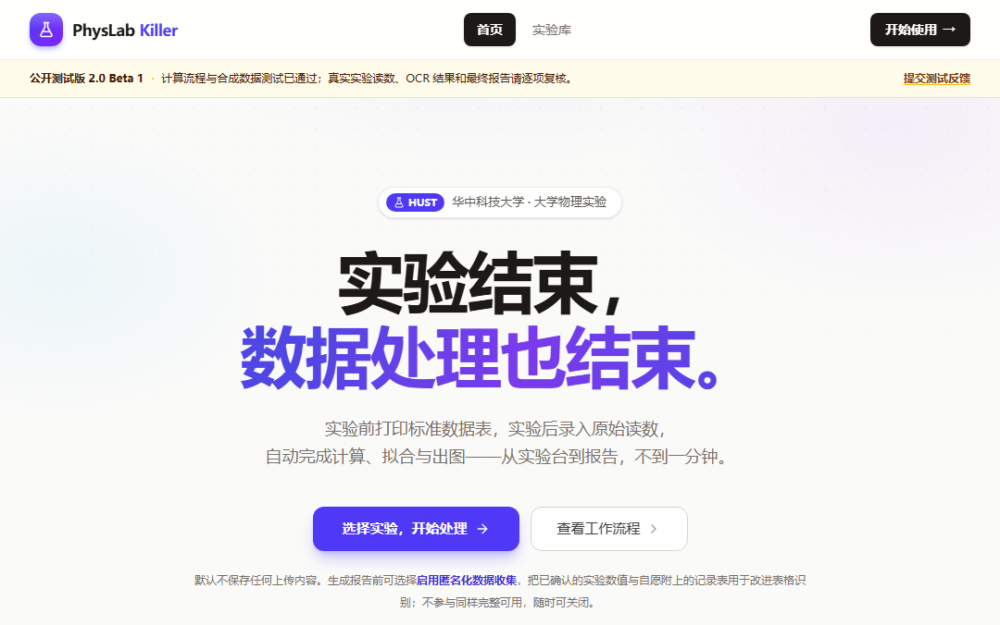

# NMSL-HUST-PhysExp

**N**ext-Generation **M**odel-Powered **S**ynthesis **L**aboratory

for HUST Physics Experiments

模型驱动的下一代华中科技大学物理实验综合平台

> a.k.a. **PhysExp Killer**

> 1. 叠甲：本仓库的设置没有任何不尊重老师的意向！实验室不乏很好的任课老师，我无意指摘他们，更不会攻击他们。然而，这并不能推翻我对物理实验这门课的意义的持续怀疑，以及它给我的大学生活造成的真实的痛苦，做这个 fork 并自费对上游 codebase 进行持续完善，无外乎一种反抗。
> 2. 本仓库含有大量的 AI 生成代码（至少本 fork 所进行的代码工程是 100% AI 的），不保证万无一失，请批判性使用，实验报告的主线依然建议参考社区分享。
> 3. 最后祝大家大学生活过得更好，希望以后实在的减负措施能够惠及更多的学弟学妹，而不是像现在一样……

- **实验数据录入** —— 手写记录表拍照上传，自动识别成数据
- **数据处理** —— 计算、误差分析、最小二乘拟合
- **曲线绘制** —— 结果图自动生成并按报告规范排版
- **实验报告** —— 一键导出含数据表、图像与计算结果的 Word / PDF，也可下载 Markdown / JSONC

> PhysExp Killer **不替代实验**。纸笔记录、动手操作、观察现象仍是实验课的核心；PhysExp Killer 只是把实验之后的数据处理与出图变成一分钟的事。

**在线使用**：<https://leonhardthust.github.io/NMSL-HUST-PhysExp/> · **问题反馈**：<https://github.com/LeonhardtHUST/NMSL-HUST-PhysExp/issues>

---

## Features

### 📷 OCR 辅助实验数据录入

上传手写实验记录表的照片，PhysExp Killer 会定位表格、切出每一个手写数值并给出识别候选。所有候选值都由你确认或修改后才进入计算。

### 📊 自动数据处理

- 数据计算：按每个实验的计算公式与单位自动处理
- 误差分析：相对误差、标准差、相关系数等
- 曲线绘制：验证性实验自动做最小二乘拟合与残差检查

### 📝 实验报告生成

一次导出即可得到：

- 数据表（含原始读数与计算结果）
- 结果图像（拟合曲线、特性曲线）
- 计算结果与误差分析

### 🤖 匿名化数据收集（可选）

生成报告前会询问一次，是否启用匿名化数据收集帮助改进服务。**完全自愿**，不参与也完整可用；决定记在浏览器里，之后不再反复询问，报告区可随时更改。

---

## 使用流程

```
1. 选择实验        2. 上传实验记录表     3. AI 辅助识别数据
        ↓                    ↓                     ↓
4. 检查并修改数据   5. 自动计算和绘图     6. 生成实验报告
```

| 步骤 | 说明 |
|---|---|
| 1. 选择实验 | 打开实验库，选择本次要做的实验（支持 12 个大学物理实验） |
| 2. 上传实验记录表 | 拍照或扫描手写记录表上传；也可以直接手动录入 |
| 3. AI 辅助识别数据 | 系统按实验模板切出每个数值并给出识别结果 |
| 4. 检查并修改数据 | 逐项确认；表格里可以直接改，超范围会给出提示 |
| 5. 自动计算和绘图 | 点击处理后自动完成计算、拟合与出图 |
| 6. 生成实验报告 | 下载 Word / PDF 报告（或 Markdown / JSONC），含数据表、图像与计算结果 |

<p align="center">
  
</p>

<table>
<tr>
<td width="50%"><br><sub>实验库：12 个大学物理实验</sub></td>
<td width="50%"><br><sub>工作台：数据录入、计算、绘图与报告</sub></td>
</tr>
</table>

## 支持的实验

| 分类 | 实验 |
|---|---|
| 光学 | 偏振光与双折射、迈克尔逊干涉实验 |
| 波动 | 声速光速的测量 |
| 电磁学 | 万用表的组装与校准、交直流电桥的原理及应用、太阳能电池特性、巨磁电阻效应及应用 |
| 近代物理 | 核磁共振实验、光电效应与弗兰克-赫兹实验 |
| 力学 | 落球法测液体粘滞系数、液体表面张力系数测量 |
| 热学 | 稳态法测固体导热系数 |

每个实验都配有标准记录表（可打印）、数据特征参考（这个实验的数据通常长什么样）与报告模板。

## 匿名化数据收集（可选）

数据收集**不是额外任务**：它和普通实验走同一个工作台、同一套流程，只是在生成报告前多问一句。

```
正常做实验 → 右上角「导出」→「完整报告」页签 → 首次询问一次（可顺手附上记录表照片）→ 生成报告
                                              ↓
              该页签常驻开关「匿名分享本次实验数据（可选）」；报告区另有一行状态，随时可改
```

- **完全自愿**：不勾选也能生成报告，随时可以在导出弹窗或报告区关闭
- **不影响正常实验**：录入、计算、绘图、报告流程完全一致
- **可以撤回贡献**：撤回后原图与由它生成的数据样本一并删除
- **本地只记一个标记**：`physlab:data-collection-consent:v1`，不含实验数据与身份信息
- **开关显示「当前部署未开放」**：说明这个部署没开启数据共建（本地开发需在 `backend/.env.local` 里加 `ENABLE_DATA_COLLECTION=true` 并重启），报告不受影响

## 数据安全

参与前请先删除或遮盖：**姓名、学号、联系方式**（以及人脸、证件等任何个人信息）。

系统会：

- 删除图片元数据：保存前重新编码，去掉拍摄时间、位置等照片信息
- 仅保存必要实验信息：只保留数值裁剪与最小必要的溯源信息
- 不公开用户实验记录：原始图片保存在私有存储中，不会进入公开仓库

<p align="center">
  
</p>

## 项目架构

```
User
 │
PhysExp Killer（vinext / Vite 界面 + FastAPI 服务）
 │
Experiment Processing（计算 · 误差分析 · 拟合绘图 · 报告）
 │
AI Data Pipeline（模板定位 · 表格切分 · 质量筛选）
 │
OCR Dataset（image, text）
 │
PhysLab_OCR（CRNN + CTC 识别模型训练）
```

PhysExp Killer 负责采集与切分，[PhysLab_OCR](https://github.com/Bogger111/PhysLab_OCR) 负责数据集与模型训练——两个仓库职责分离。

## 开发状态

**当前（2.0）**

- 支持 12 个大学物理实验的录入、计算、绘图与报告
- 支持实验记录表 OCR 辅助录入（候选值须人工确认）
- 支持匿名化数据收集闭环：自愿同意 → 采集 → 确认 → 切分 → 训练集导出
- 后端 581 项、前端 100 项自动测试全部通过（后端另有 3 项跳过：缺 `.env.local` 与未暴露公式的实验）

**未来**

- 更多实验（力学、热学、电磁学、近代物理持续接入）
- 更强的 OCR 模型：用匿名化收集的数据训练后的识别能力提升
- 更多智能实验辅助功能

> 验证边界：计算链、记录表、报告与 OCR 管线均已通过自动测试与合成数据验证；真实手写数据与真实实验读数的端到端验证仍在进行，发布版中的所有 OCR 候选值都需要人工确认。

## 本地运行（开发者）

### 一键脚本

仓库根目录带一个 `package.json`，用 npm 脚本即可启动/构建/部署，跨平台（Windows / macOS / Linux）：

| 命令 | 作用 |
|---|---|
| `npm run dev` | 开发模式：后端 `uvicorn --reload` + 前端 `vinext dev`（Vite），改代码即时生效 |
| `npm run build` | 只构建前端（`vinext build` 静态导出到 `frontend/out`） |
| `npm run prod` | 先构建，再以**生产产物**启动（后端不带 `--reload` + 静态服务器），页面不再实时渲染，明显更流畅 |
| `npm run stop` | 停掉占用 8001 / 3000 的进程 |
| `npm run mcp` | 前台启动本地 MCP Server（stdio，供 AI 客户端接入；不监听端口，见下） |
| `npm run mcp:check` | 打印 MCP 工具清单自检，不进入协议、不常驻 |
| `npm run mcp:config` | 按当前机器生成可直接粘贴的 MCP 客户端配置（绝对路径自动填好） |
| `npm run deploy` | 一键部署到 CloudBase：后端云托管 + 前端静态托管，详见「部署到 CloudBase」 |
| `npm run deploy:backend` | 只重建云托管容器 |
| `npm run deploy:frontend` | 只构建并上传前端静态产物 |

`npm run dev / build / prod / stop` 只是转发到下面的脚本；需要细粒度参数时直接用脚本（`deploy` 系列不转发，直接在 Node 里执行部署流水，见「部署到 CloudBase」）：

```bash
npm run prod -- --no-browser --detach     # 构建 + 后台生产模式，不弹浏览器
```

脚本：`scripts/dev.ps1`（Windows PowerShell 5.1 / PowerShell 7）与 `scripts/dev.sh`（bash）。默认**独占当前控制台**运行：日志实时打印、`Ctrl+C` 同时停掉前后端；加 `-Detach` / `--detach` 转后台。

| 环境 | 前台启动 | 后台启动 | 停止 |
|---|---|---|---|
| Windows PowerShell 5.1 | `.\scripts\dev.ps1` | `.\scripts\dev.ps1 -Detach` | `.\scripts\dev.ps1 -Stop` |
| PowerShell 7（pwsh） | `pwsh -File .\scripts\dev.ps1` | `pwsh -File .\scripts\dev.ps1 -Detach` | `pwsh -File .\scripts\dev.ps1 -Stop` |
| Git Bash / Linux / macOS | `./scripts/dev.sh` | `./scripts/dev.sh --detach` | `./scripts/dev.sh --stop` |

参数：

| PowerShell | bash | 作用 |
|---|---|---|
| `-Build` | `--build` | 只构建前端（导出到 `frontend/out`）后退出 |
| `-Prod` | `--prod` | 先构建，再用生产产物启动前后端 |
| `-Install` | `--install` | 强制重装 Python 与 npm 依赖 |
| `-Detach` | `--detach` | 转入后台运行，日志写入 `.dev-logs/` |
| `-Stop` | `--stop` | 停止占用这两个端口的进程后退出 |
| `-NoBrowser` | `--no-browser` | 不自动打开浏览器 |
| `-BackendPort` | `-b, --backend-port` | 后端端口，默认 8001 |
| `-FrontendPort` | `-f, --frontend-port` | 前端端口，默认 3000 |

脚本做的事：首次运行创建 `.venv` 并安装 `backend/requirements.txt`、`frontend/` 执行 `npm ci`；清理端口后启动后端与前端，轮询 `/health` 和首页直到就绪（各 180 秒上限），失败会提示看日志。

- 开发模式：前端 <http://localhost:3000>（`vinext dev`，热更新；**只监听 `localhost` / IPv6 `::1`**，用 `127.0.0.1` 连不上）；生产模式：同一个地址，服务的是 `frontend/out` 静态产物，适合演示与验收。
- 后端始终是 <http://127.0.0.1:8001>（API 文档 `/docs`）；前端在构建期把 `NEXT_PUBLIC_API_URL` 内联进产物（默认 `http://localhost:8001`），Oracle 部署下该变量为空、由 nginx 反代同源 `/api/`。
- `npm run prod` 每次都会重新构建；只想看页面就反复用同一个 `prod` 命令即可（构建约 20 秒）。
- 前台模式按 `Ctrl+C` 停止；后台模式用 `-Stop` / `--stop`，日志见 `.dev-logs/`（已被 `.gitignore` 覆盖）。
- PowerShell 报「禁止运行脚本」时：`powershell -ExecutionPolicy Bypass -File .\scripts\dev.ps1`。
- Windows 上跑 bash 版本请用 Git Bash（`.venv/Scripts/python.exe` 与 `.venv/bin/python` 脚本会自行识别）。
- 生产模式的静态服务器是仓库自带的零依赖脚本 `scripts/serve-static.mjs`（等价于 CI 上的静态托管：目录补 `/` 重定向、`index.html` 落盘、404 页面）。

#### `scripts/` 目录

| 文件 | 运行环境 | 作用 |
|---|---|---|
| `dev.ps1` | Windows（PowerShell 5.1 / PowerShell 7） | 主启动脚本：依赖安装、端口清理、`-Build` / `-Prod` / `-Detach` / `-Stop` |
| `dev.sh` | bash（Git Bash / Linux / macOS） | 与 `dev.ps1` 等价，参数为 `--build` / `--prod` / `--detach` / `--stop` |
| `dev.mjs` | 跨平台（npm 脚本入口） | `npm run dev / build / prod / stop` 的分发器，自动选用上面的 `.ps1` 或 `.sh` |
| `serve-static.mjs` | 跨平台 | 生产模式的零依赖静态服务器，托管 `frontend/out`（目录补 `/` 301、`index.html` 落盘、MIME、缓存头、404） |
| `mcp.mjs` | 跨平台（npm 脚本入口） | `npm run mcp` / `mcp:check` / `mcp:config` 的实现：定位 `.venv` 解释器、检查 `mcp` 依赖，再转发到 `backend/mcp_server.py`；`mcp:config` 只打印配置片段不启动 server |
| `deploy.mjs` | 跨平台（npm 脚本入口） | `npm run deploy / deploy:backend / deploy:frontend` 的实现：预检环境、云托管部署、解析并缓存 API 地址、注入构建、上传静态托管 |
| `export_ocr_dataset.py` | 跨平台（Python） | 导出经用户明确同意并确认的记录，供后续 OCR 研究使用；不做训练、裁剪或识别 |
| `generate_simulated_reports.py` | 跨平台（Python） | 生成整套合成报告，用于打印排版 QA（数字仅为夹具，不代表真实结果正确性） |

`npm run dev / build / prod / stop` 只负责参数转发，脚本本身可直接调用，例如 `.\scripts\dev.ps1 -Prod -Detach -NoBrowser` 或 `./scripts/dev.sh --prod --detach --no-browser`。`deploy` 系列不转发到 `.ps1` / `.sh`，由 `scripts/deploy.mjs` 直接执行部署流水（`node scripts/deploy.mjs --help` 看参数）。

### 前端工具链：Vite+（`vp`）

前端已迁移到 **vinext（Vite 8 / Rolldown）+ Vite+**。`frontend/` 的 `dev` / `build` / `test` / `check` 全部由 Vite+ 提供，配置集中在 `frontend/vite.config.ts`：

| 命令（在 `frontend/` 下） | 作用 |
|---|---|
| `npm run dev` | `vinext dev`，Vite 开发服务器（端口 3000） |
| `npm run build` | 静态导出到 `frontend/out`（内部先跑 `vinext build`，`basePath` 非空时再由 `scripts/build.mjs` 拆平目录） |
| `npm test` | `vp test`（Vitest 5），15 个文件 / 100 个用例 |
| `npm run check` | `vp check --no-fmt`：Oxlint + 类型检查（格式检查暂未纳入准入） |
| `npx vp build` | 等价于 `npm run build`，但**不经过** `scripts/build.mjs`，只适合 `NEXT_PUBLIC_BASE_PATH` 为空的本地校验 |

仓库根目录的 npm 脚本仍可用 Vite+ 的任务运行器跑，`vpr` 是 `vp run` 的简写：

| npm | Vite+ |
|---|---|
| `npm run dev` | `vpr dev` 或 `vp run dev` |
| `npm run build` | `vpr build` |
| `npm run prod` | `vpr prod` |
| `npm run stop` | `vpr stop` |
| `npm run mcp` | `vpr mcp` |
| `npm run mcp:check` | `vpr mcp:check` |
| `npm run mcp:config` | `vpr mcp:config` |
| `npm run deploy` | `vpr deploy` |

- **附加参数不要写 `--`**：npm 会吞掉 `--`，`vpr` 则把它原样传给脚本（`vpr prod -- --no-browser` 会被 `dev.mjs` 当成未知参数拒绝）。Vite+ 用户请直接写 `vpr prod --no-browser`、`vpr dev --no-browser`。
- 只写 `vpr run <task>` 会报 `Task "run" not found`：`vpr` 本身已经是 `vp run`，长写法用 `vp run <task>`。
- 尽量用长参数（`--no-browser` 而不是 `-d`）：`vp run` 自己会解析 `-r` / `-F` / `-v` 等短选项。
- 需要 Node `>=22.18`（`vinext` engines `>=22`、`vite-plus` engines `^22.18 || ^24.11 || >=26`）。

### 手动启动

```bash
# 后端
cd backend && pip install -r requirements.txt
uvicorn app.main:app --port 8001

# 前端
cd frontend && npm install && npm run dev
```

开发开关（可选，默认关闭匿名化数据收集）：`backend/.env.local`

```bash
ENABLE_DATA_COLLECTION=true     # 打开匿名化数据收集
PHYSICSLAB_DEV_MODE=true        # 打开开发者统计面板
```

### MCP Server（可选，仅本地）

PhysExp Killer 也能作为 MCP Server 被 AI 客户端（codex / opencode / CodeBuddy / Claude Desktop）直接调用：选实验、校验数据、计算绘图、生成 Word/PDF/Markdown/JSONC 报告与记录表。它与网页**共用同一套计算核心**。

**MCP 只在本机运行**：不监听端口、不走网络、不随 `npm run deploy` 或云端镜像一起部署——`backend/Dockerfile` 不打包它，`backend/.dockerignore` 也把它排除在构建上下文外。上云的只有 `uvicorn` 暴露的 HTTP 后端。

```bash
npm run mcp:check      # 打印 9 个工具的自检清单（stderr），不进入协议、不常驻
npm run mcp:config     # 按当前机器生成可粘贴的客户端配置（绝对路径已填好）
npm run mcp            # 前台启动 stdio 服务器，Ctrl+C 结束；AI 客户端会自己拉起 python 入口
```

```json
{
  "mcpServers": {
    "physlab": {
      "type": "stdio",
      "command": "<仓库>/.venv/Scripts/python.exe",
      "args": ["<仓库>/backend/mcp_server.py"]
    }
  }
}
```

产物（报告、记录表、拟合图）写入系统临时目录下的 `physlab-mcp/`，用 `PHYSICSLAB_MCP_OUTPUT_DIR` 可指定固定目录。数据收集相关工具默认不注册，需 `PHYSICSLAB_MCP_ENABLE_DATA_COLLECTION=true` 且后端 `ENABLE_DATA_COLLECTION=true`。

配置写法、工具清单、`data` 三种结构与排障见 [docs/mcp.md](docs/mcp.md)。

更多细节见 [docs/architecture.md](docs/architecture.md)（架构与流水线）、[docs/report-format.md](docs/report-format.md)（报告导出格式与 JSONC schema）、[docs/screenshots.md](docs/screenshots.md)（截图清单）、[CHANGELOG.md](CHANGELOG.md)（发布说明）。

## 部署到 CloudBase

仓库根目录的 `cloudbaserc.json` 记录目标环境。`npm run deploy` 依次完成：部署后端云托管容器 → 取回公网地址 → 带该地址构建前端 → 上传 `frontend/out` 到静态托管。

前置（只需一次）：

```bash
npm i -g @cloudbase/cli
tcb login          # 国际站环境先执行 tcb config set isIntl true
```

| 命令 | 作用 |
|---|---|
| `npm run deploy` | 完整流水：后端容器 + 前端构建上传 |
| `npm run deploy:backend` | 只重建云托管容器 |
| `npm run deploy:frontend` | 只构建并上传前端，复用上次解析到的 API 地址 |

常用参数（`npm run deploy -- --help` 查看全部）：`--env <envId>`（也可用 `TCB_ENV_ID` 覆盖 `cloudbaserc.json`）、`--api-url`、`--site-origin`、`--skip-backend`、`--skip-frontend`、`--skip-build`、`--dry-run`。

- 前端把 API 地址编译进产物，所以顺序固定为「先容器、后前端」；解析到的地址缓存在 `.dev-logs/cloudbase.json`，后端已可用时加 `--skip-backend` 只发前端。
- 静态托管域名在首次部署后才存在：把它写进 `deploy/cloudbase.env.json` 的 `CORS_ORIGINS`，再跑 `npm run deploy:backend` 让跨域生效。
- 云托管按 `deploy/cloudbase.env.json` **整体覆盖**环境变量（不是合并），改配置请改这个文件。
- 首次容器构建约 3–8 分钟（`pip install` 与中文字体），之后走镜像层缓存。
- `--dry-run` 只打印将执行的 `tcb` 命令，不产生任何云端变更。
- 容器里只有 `uvicorn` 的 HTTP 后端：**MCP 不上云**（`backend/Dockerfile` 不打包 `mcp_server.py`，`backend/.dockerignore` 把它排除在构建上下文外），MCP 只在本机给 AI 客户端用。
- 日志写入 `.dev-logs/cloudbase-*.log`，完整输出不在控制台刷屏。

它和 GitHub Pages、Oracle、Cloudflare 三条通道并列，细节见 [docs/deployment.md](docs/deployment.md)。

## 反馈

- 使用问题与建议：<https://github.com/LeonhardtHUST/NMSL-HUST-PhysExp/issues>
- 匿名化数据收集相关疑问（授权、撤回、隐私）：同样通过 issue 联系

---

HUST 华中科技大学 · 大学物理实验
